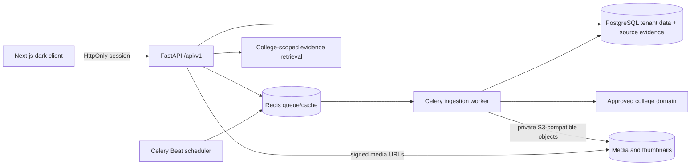

# Architecture

Identity and tenant context come from the signed server-side session. Admin operations bind to the authenticated user's college ID. College answers are retrieved from rows belonging to that college and include source URLs when sourced from a crawled page. Missing evidence returns “Not available”; the current MVP does not call a generative model for college facts.

PostgreSQL is the deployment database. Alembic owns schema versioning; the local development fallback is SQLite. Raw page text is retained with URL and content hash before its page record is referenced by the catch-all fact store. Queue jobs are retried by Celery. The crawler currently restricts requests to the registered source host, checks robots.txt, removes tracking parameters, and rejects private/reserved IP resolution.
