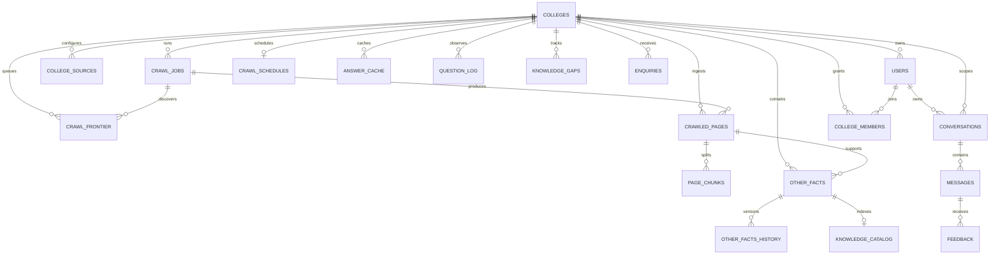

# Data model

`other_facts` is the flexible evidence store. Each fact points to its source page when available, receives a catalog entry through SQLAlchemy insert/update/delete listeners, and keeps prior values in `other_facts_history`. Tenant-owned tables carry `college_id`; conversation access additionally checks the authenticated user. PostgreSQL RLS is enabled by the initial migration as a second tenant boundary.
